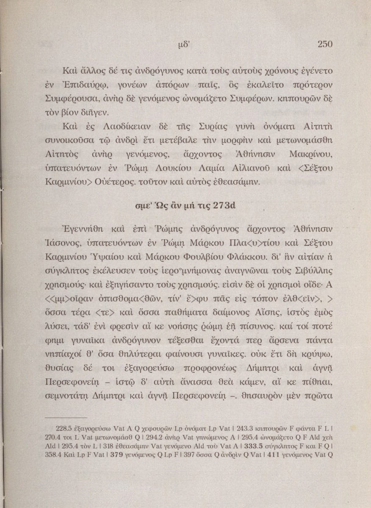
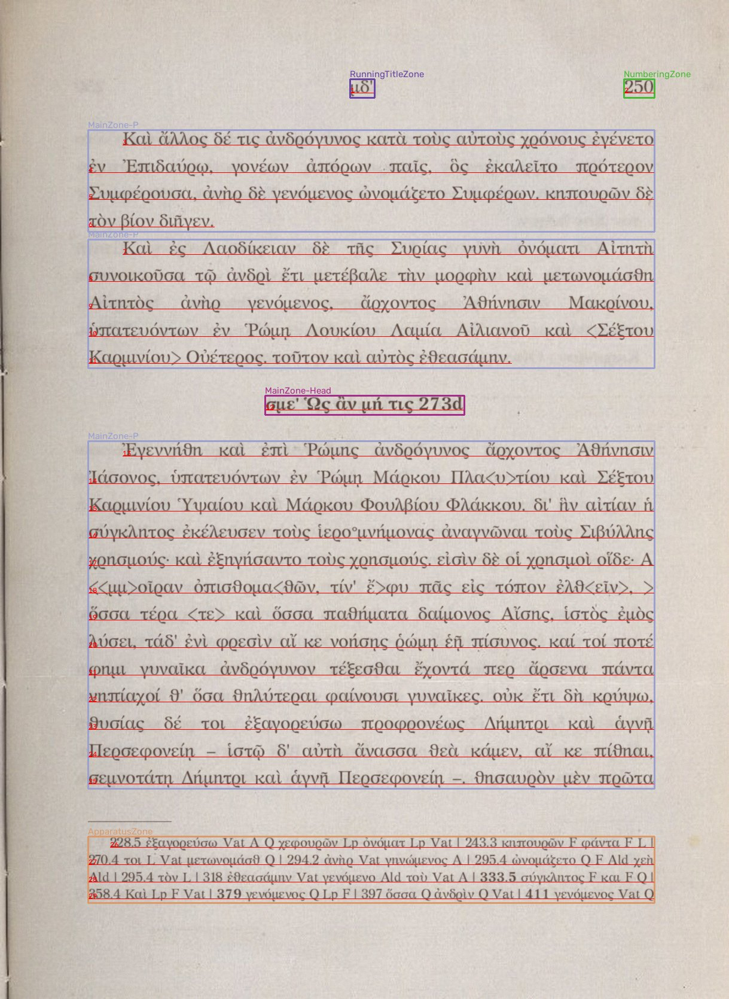
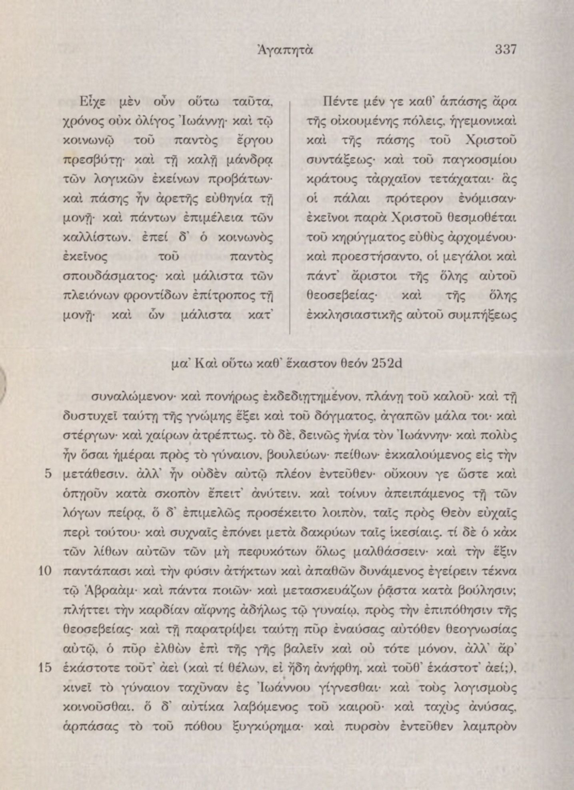
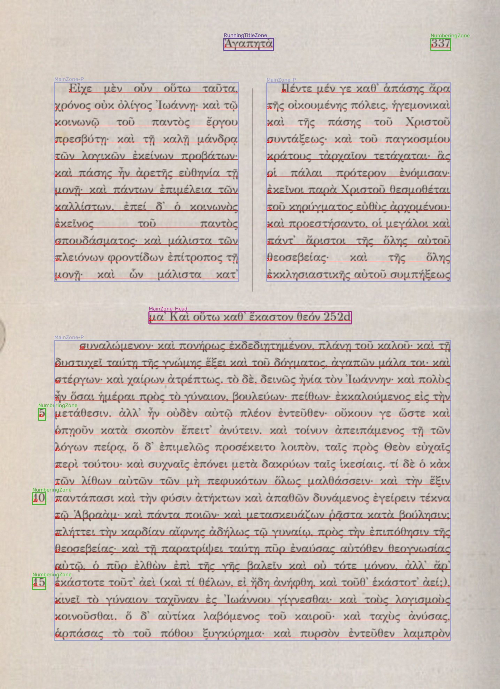

# cllg-synth-segmentation

Synthetic Greek page-segmentation data: ALTO v4 (+ JPG) in the [CLLG Closed Segmentation](https://zenodo.org/records/24187107) vocabulary.


```
    uv venv env && uv pip install -p env/bin/python -r requirements.txt
    env/bin/python -m synth.generate --n 1000 --out out --seed 0 --workers 8 [--overlay] [--parallel P | --parallel-only] [--start N]
    env/bin/python -m pytest tests
```

Two-column pages: `--parallel P` gives each prose page a probability P of containing a parallel-text band; `--parallel-only` generates
only such pages (prose, always with a band). `--start N` numbers pages from N and appends to an existing output dir and its `splits.tsv`.
`examples/` holds 1000 ordinary pages (`synth_000000`–`synth_000999`) followed by 200 `--parallel-only` pages (`synth_001000`–`synth_001199`, seed 7).

Output: `out/synth_NNNNNN.{jpg,xml}`, `out/splits.tsv` (train/val/test), `out/overlay/` with `--overlay`.
Modules: `corpus` (TEI loader, cached in `cache/`), `fonts`, `apparatus` (fake critical apparatus), `layout` (templates + reading order),
`augment` (paper compositing, bleed-through, shadows, perspective/rotation applied to geometry too), `altoio` (ALTO writer, copied from closed-segmentation).

# Example

| Page (JPG) | Overlay (`--overlay`) |
|---|---|
|  |  |

The matching ALTO file is generated alongside each page as `synth_NNNNNN.xml`.

## Two-column (parallel text) pages

Part of a prose page is sometimes set in two columns (a text and its parallel version), then the page returns to a single column
(or the columns run to the bottom of the page). Characteristics of the generated layout:

- blank space above and below the band, and a blank gutter between the columns (1.5–4 × the font size);
- sometimes a thin vertical separator rule centred in the gutter;
- sometimes one column stops early (never both), leaving blank space under it, or the right column starts a line or two lower;
- each column paragraph is a `MainZone-P`; there is no dedicated region type;
- reading order: the left column entirely, then the right column, at the position where the band starts.

| Page (JPG) | Overlay (`--overlay`) |
|---|---|
|  |  |

# Segmentation types

## Regions (TextBlock)

| Type | What it is | How it is decided |
|---|---|---|
| `MainZone-P` | One paragraph of the main text: a prose paragraph, a scholion or gloss, a commentary paragraph, one bibliography entry. A paragraph may be a single line (e.g. `223 a.`). | New paragraph at: first-line indent (prose), a flush-left line on hanging-indent pages (bibliographies), a bold lemma number (`222`, `153–4c`) or a sub-label (`b.`, `c.`) in scholia, or a vertical gap above 1.6 line pitches. |
| `MainZone-Continued` | The block at the top of a page that continues a paragraph from the previous page. | The first main block on the page, when it does not open at a paragraph start and no apparatus lies above it. If an apparatus block precedes it, it is a plain `MainZone-P`. |
| `MainZone-Head` | Headings and titles inside the main text: treatise or section titles, scholia section headings, `fragm. 3`. | An isolated block (white space above and below, more than 1.4 line pitches) of centred lines at body size that are not left-aligned and shorter than 88% of the text width. In verse books, lines matching `fragm.` / `fragmenta` / a single capital / a papyrus number, centred on the page. A running-title-like centred line directly above such a block belongs to it. Centred lines inside running verse (elegiac couplets) are not headings. |
| `MainZone-Lg` | Verse: the main text of a poetry edition, and verse quotations inside prose (ragged right, deeply indented). | `--verse` mode for poetry books. In prose books, a run of lines indented more than 20 pt beyond the flush margin whose right edge is ragged. |
| `MainZone-Quote` | A justified prose quotation inside prose. | Same deep-indent run as `Lg`, but justified to the right margin. |
| `NumberingZone` | Numbers that are not part of the text: page number, line numbers (5, 10, 15…), passage references in the margin (`245c`). Lemma numbers are not numbering, they belong to their `MainZone-P`. | Digit-like or very short text in the header band, or outside the text block. |
| `RunningTitleZone` | The running head at the top of the page. | First baseline cluster at the top, closed by a gap larger than 1.45 line pitches, at most 4 lines. |
| `MarginTextZone` | Marginal text that is not a number: sigla (`D`, `B`), `169 K.`, marginal glosses. | Text outside the body block that is not digit-like. |
| `ApparatusZone` | The critical apparatus and similar notes set in a smaller font. One zone per block (per scholion in scholia). | Font size below the main size, below the body. A small line wrapped off the end of an apparatus entry (even left of the text column) stays apparatus. |
| `TableZone` | A ruled table, one zone per table, with all its cells inside. | A cluster of long horizontal and vertical vector rules in the PDF. |

## Lines (TextLine)

| Type | Used for |
|---|---|
| `DefaultLine` | Any ordinary line of main text, numbering, running title or table cell. |
| `DefaultLine-Margin` | A line of marginal text (inside `MarginTextZone`). |
| `HeadingLine` | A line of a heading (inside `MainZone-Head`). |
| `ApparatusLine` | A line of apparatus (inside `ApparatusZone`). |

## Reading order

Stored per line, explicitly, in `<ReadingOrder><OrderedGroup ID="ro_0"><ElementRef ID="o_n" REF="line_n"/>…`,
placed between `<Tags>` and `<Layout>`, the way Kraken writes and reads it (`XMLPage.line_orders`).
Regions are not listed; the `TextBlock` order in the file follows region position.

Rules, applied to lines:

1. Header band first: running title and page number, top to bottom.
2. Everything else top to bottom by baseline (apparatus therefore follows the text above it, scholion then its apparatus).
3. Lines whose baselines are within 3.5 pt share a row and are read left to right. So marginal numbering and notes
   are read in the order they appear: a left-hand passage number (`245c`) or line number comes before the
   text beside it, a right-hand number (`5`, `10`) after it. Margin notes are not collected in a group at the end.
4. Table cells are read column by column (top to bottom, columns left to right). Likewise a two-column parallel-text band is read left column first, then right column.